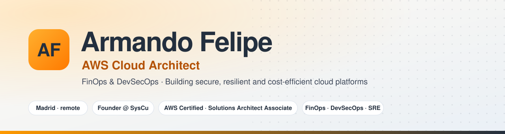
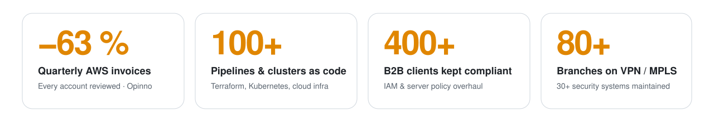
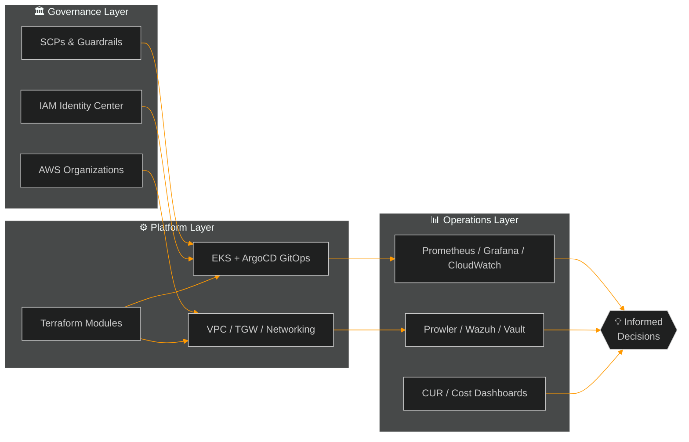

<picture>
  <source media="(prefers-color-scheme: dark)" srcset="assets/header-dark.svg">
  
</picture>

 

   

## ⚡ Now

- 🌱 **Founder @ [SysCu](https://www.syscu.es/)** — DevOps & FinOps on AWS for companies in Spain.
- 🧪 **Open-sourcing FinOps tooling**, like [syscu-kiro-report-usage](https://github.com/syscu-es/syscu-kiro-report-usage): one command, one HTML file, Kiro usage and cost per user.
- ✍️ **Writing** about FinOps, ECS, Bedrock AgentCore and AI at work on [LinkedIn](https://www.linkedin.com/in/armandofcom/recent-activity/all/) (2,200+ followers).

## 📈 Impact

<picture>
  <source media="(prefers-color-scheme: dark)" srcset="assets/impact-dark.svg">
  
</picture>

Opinno, 2023–2026 (cloud engineer, independent). Figures from my [LinkedIn experience](https://www.linkedin.com/in/armandofcom/).

## 🧭 What I do

| ☁️ **Cloud architecture** | 💸 **FinOps** | 🔐 **DevSecOps** |
|---|---|---|
| Multi-account AWS, landing zones, networking, migrations and disaster recovery. | Cost allocation, tagging, rightsizing and spend made visible to engineering and business. | Security as code, secrets, IAM/RBAC, Zero Trust, GDPR and ISO 27001 controls in the pipeline. |
| 🧱 **Platform & IaC** | ☸️ **Containers** | 📡 **SRE & observability** |
| Terraform / OpenTofu modules, GitOps, repeatable delivery. | EKS, ECS Fargate, Nomad, Consul, Helm, ArgoCD. | Metrics, logs, traces and SLOs: CloudWatch, Prometheus, Grafana, ELK. |

<b>🏗️ How I think — a reference architecture</b>

**Security by design. Observability by default. Cost-awareness always.**

## 🧳 Experience

| When | Role | Where |
|---|---|---|
| Now | **Founder** | [SysCu](https://www.syscu.es/) — DevOps & FinOps on AWS |
| 2025 – 2026 | Senior Cloud Systems Architect | Paradigma Digital · remote, Madrid |
| 2023 – 2026 | Cloud Engineer | Opinno Ecuador · independent |
| 2024 – 2025 | DevOps Engineer | CloudAPPi · hybrid, Madrid |
| 2023 – 2024 | DevOps Team Lead | Irontec · remote, Bilbao |
| 2016 – 2024 | CEO | SysAdmins de Cuba · community |

🎓 Computer Science Engineering (in progress) — Universidad de las Ciencias Informáticas.

## 🛠️ Stack

<picture>
  <source media="(prefers-color-scheme: dark)" srcset="https://skillicons.dev/icons?i=aws%2Cterraform%2Ckubernetes%2Cdocker%2Cansible%2Cpython%2Cbash%2Cgo%2Cgithubactions%2Cgitlab%2Cprometheus%2Cgrafana%2Clinux%2Cpostgres&perline=14&theme=dark">
  
</picture>

Also: OpenTofu · Vault · Consul · Nomad · ArgoCD · OpenStack · Prowler · Wazuh · CloudWatch · ELK · Sentry.

## 🧩 Open source

| Project | What it does | |
|---|---|---|
| [**syscu-kiro-report-usage**](https://github.com/syscu-es/syscu-kiro-report-usage) | Self-contained HTML report of **Kiro** usage and cost per IAM Identity Center user. Works with any AWS account through SSO. |  |
| [**ECS-RDS-Control-Dashboard**](https://github.com/armandofcom/ECS-RDS-Control-Dashboard) | Internal ops panel to start/stop ECS services and RDS databases, with authentication, short-lived tokens and centralised visibility. |  |
| [**awscert**](https://github.com/syscu-es/awscert) | AWS certification practice-exam simulator covering all current AWS certifications. |  |

## ✍️ Recent writing

On [LinkedIn](https://www.linkedin.com/in/armandofcom/recent-activity/all/), in Spanish:

- **«Un agente de IA sin guardrails es una API pública con imaginación»** — a Bedrock AgentCore reference flow, simulated with and without guardrails.
- **«El meme es un chiste. La factura no.»** — ECS Gateway: 25 ALBs vs. one shared ALB, and where the saving stops being the point.
- **«Sácate la certificación y te cambia la carrera… ¿Seguro?»** — what an exam measures and what a senior's week actually looks like.
- **«La IA te va a ahorrar horas de trabajo… ¿Seguro?»** — who gets the hours AI frees up.

## 🏅 Certifications

| Certification | Issuer | Date |
|---|---|---|
| **AWS Certified Solutions Architect – Associate** | AWS | Sep 2024 |
| **AWS Certified Cloud Practitioner** | AWS | Dec 2023 |
| **Well-Architected Proficient** | AWS | Nov 2024 |
| DevOps Professional Certificate | PagerDuty × LinkedIn | Jun 2026 |
| Introduction to FinOps (course) | FinOps Foundation | Aug 2025 |

<b>🎓 Training badges — 84 on Credly</b> (learning credentials, not professional certifications)

 

- **AWS Partner:** Kiro Learning Plan · Agentic AI Essentials · Generative AI Essentials · Cloud Operations Essentials · DevOps Essentials · Cloud Economics Essentials · Migration Acceleration Program Authorized
- **Linux Foundation:** Kubernetes · OpenTofu · GitOps · OpenTelemetry · Istio · Jenkins · DevSecOps for Managers · DevOps & SRE
- **Google:** Cybersecurity Professional Certificate · IT Automation with Python · Apigee X
- **Others:** LPI Linux Essentials · Cisco networking and cybersecurity paths · Scrum Foundation

All of them, verifiable, on [Credly](https://www.credly.com/users/armandofcom/badges).

## 🌍 Community

- 🇨🇺 **SysAdmins de Cuba** — CEO and community lead, 2016–2024: IT professionals sharing systems, Linux, DevOps and cloud knowledge.
- 🐧 **GUTL** (Free Technology Users Group) — coordinator since 2010 · **CubaConf** — event organiser since 2016.
- 📡 **FRCUBA** — designed the internet connectivity and routing for the Cuban radio amateurs' federation, serving about 3,900 users.

## 🐍 Activity

<picture>
  <source media="(prefers-color-scheme: dark)" srcset="https://raw.githubusercontent.com/armandofcom/armandofcom/output/github-contribution-grid-snake-dark.svg"/>
  <source media="(prefers-color-scheme: light)" srcset="https://raw.githubusercontent.com/armandofcom/armandofcom/output/github-contribution-grid-snake.svg"/>
  
</picture>

<b>🇪🇸 Resumen en español</b>

 

Soy **Armando Felipe**, arquitecto cloud en España. Diseño plataformas AWS seguras y eficientes en costes (landing zones multi-cuenta, EKS/ECS, Terraform), con DevSecOps, SRE y FinOps. Fundé **[SysCu](https://www.syscu.es/)**, consultora de DevOps y FinOps en AWS para empresas en España, y lideré durante siete años la comunidad **SysAdmins de Cuba**.

¿Quieres bajar tu factura de AWS? [Pide el diagnóstico gratuito](https://www.syscu.es/contacto).

SysAdmin de alma · Cloud Architect de profesión · DevSecOps por responsabilidad · SRE porque producción no perdona · FinOps para que AWS no te cobre hasta los pensamientos.

